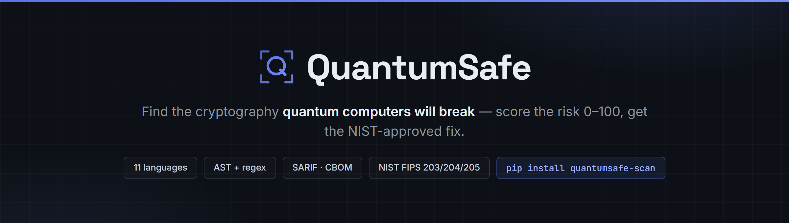
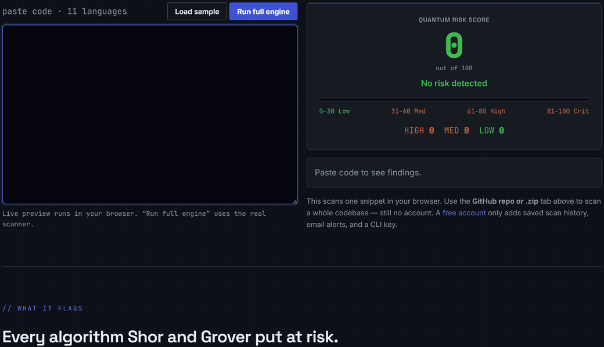
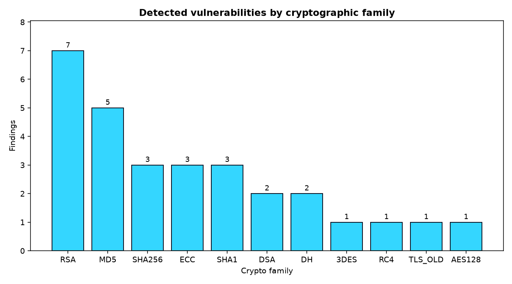
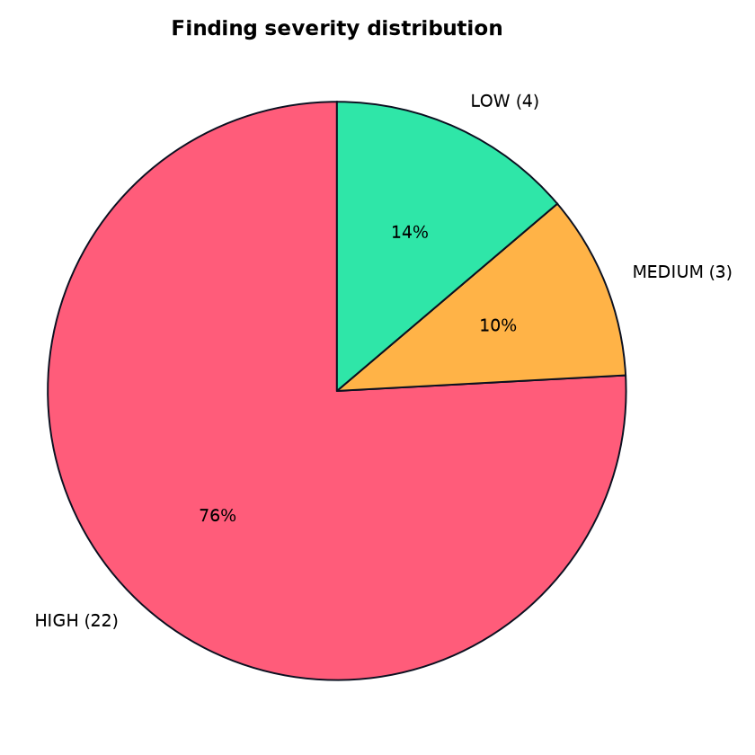
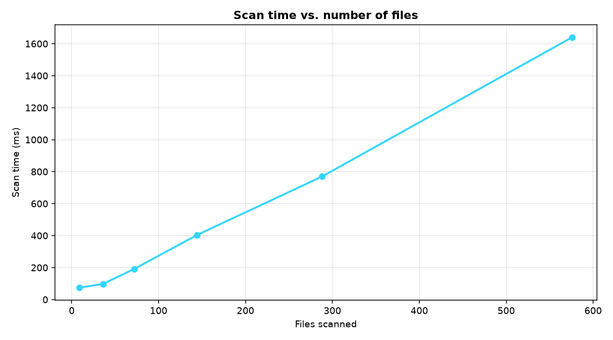
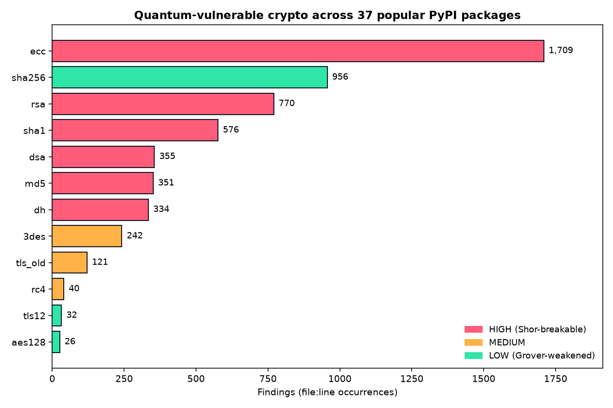
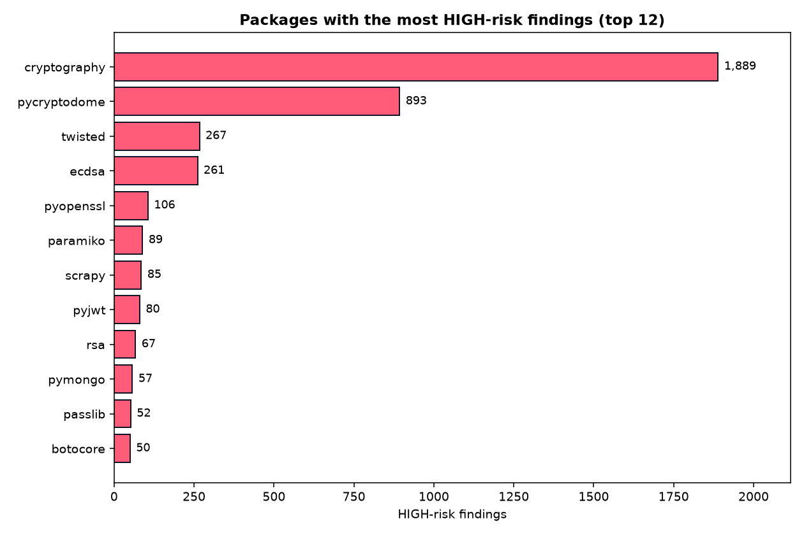

<div align="center">



<p>
  <a href="https://pypi.org/project/quantumsafe-scan/"></a>
  
  <a href="https://github.com/Danny-397/Quantum-Safe-Scan/actions/workflows/ci.yml"></a>
  <a href="https://github.com/Danny-397/Quantum-Safe-Scan/tags"></a>
  <a href="https://github.com/Danny-397/Quantum-Safe-Scan"></a>
  
  
  <br>
  
  
  
  
  
</p>

<strong>Scan your code for the encryption quantum computers will break, score it 0&ndash;100, and get the NIST-approved replacement for every finding &mdash; free &amp; open source.</strong>

<br><br>

<a href="https://quantumsafescan.com"><b>Live demo</b></a> &nbsp;&middot;&nbsp;
<a href="https://pypi.org/project/quantumsafe-scan/"><b>Install</b></a> &nbsp;&middot;&nbsp;
<a href="docs/WHITEPAPER.md"><b>Documentation</b></a> &nbsp;&middot;&nbsp;
<a href="#the-three-layers"><b>How it works</b></a> &nbsp;&middot;&nbsp;
<a href="https://github.com/Danny-397/Quantum-Safe-Scan/issues"><b>Report a bug</b></a>

</div>

QuantumSafe scans code across 11 languages for the cryptography that quantum
computers will break (RSA, ECC, Diffie-Hellman) or weaken (AES-128, SHA-256),
scores the risk 0–100, and maps every finding to its NIST FIPS 203/204/205
replacement — backed by a real Qiskit implementation of Shor's and Grover's
algorithms and a from-scratch lattice (LWE) key-encapsulation mechanism.

<p align="center">
  <a href="https://quantumsafescan.com">
    
  </a>
</p>

> ⚠️ **Disclaimer.** QuantumSafe is a security-awareness and triage tool. It uses
> static pattern + AST analysis and is **not** a substitute for a professional
> cryptographic audit. Findings are heuristic and may include false
> positives/negatives.

---

## The three layers

QuantumSafe covers the full arc of the post-quantum problem — not just naming it,
but **executing** the attack, **finding** the vulnerable code, and **running** the
solution:

| Layer | Module | What it does |
|-------|--------|--------------|
| **1. Attack** | [`quantum/`](quantum/) | Shor's and Grover's algorithms in **Qiskit**, run on a quantum simulator. At simulator scale Shor factors a small number and reconstructs a toy RSA key — an educational demonstration of *why* RSA/ECC are rated HIGH (not a break of real key sizes). |
| **2. Detection** | [`cli/`](cli/) | A hybrid **AST + regex** static-analysis engine over 11 languages, with cross-language usage-awareness, **dependency + lockfile scanning**, **reachability ranking**, and **call-site-specific fixes**, that scores risk and produces a NIST-aligned migration plan. **100% precision on the labeled [benchmark](benchmark/)** (18 files), **100% recall on 50 seeded cases**, and **93% precision (95% CI 86–97%) on a random, hand-labeled sample of 100 findings in real PyPI packages** — see [methodology](benchmark/RESULTS.md) and [real-code precision](benchmark/RESULTS-precision.md). |
| **3. Fix** | [`pqc/`](pqc/) | A from-scratch **lattice (LWE) key-encapsulation mechanism** — the math behind CRYSTALS-Kyber / ML-KEM — so the recommended fix is runnable and provable. |

The detection layer ships through three surfaces that share **one** engine:

- A **free CLI** (`pip install quantumsafe-scan`) — scan local dirs or public GitHub
  repos (and their **dependency manifests**); export JSON / HTML / SARIF / CBOM / SVG badge.
- A **Flask REST API** — powers the dashboard, ingests scans, handles auth.
- A **dark, terminal-style web dashboard** — scan history, findings, migration
  plans, and exports. **Free, no paywall.**

---

## Why it matters

RSA-2048 and elliptic-curve crypto secure almost everything — HTTPS/TLS,
certificates, SSH, code signing, VPNs. **Shor's algorithm breaks all of it.** The
math is settled; only the hardware is missing (RSA-2048 needs millions of
error-corrected qubits, and today's machines have a few hundred noisy ones).

That gap is the reason to act now, not later:

- **"Harvest now, decrypt later":** an adversary can record encrypted traffic
  today and decrypt it once the hardware exists. Anything that must stay secret
  for 5–15 years is effectively at risk *now*.
- **Migration is slow:** swapping cryptography across a large codebase takes years
  — which is why NIST finalized the post-quantum standards (FIPS 203/204/205) in
  2024.

QuantumSafe makes that migration tractable: **find** the vulnerable crypto,
**understand** why it's vulnerable, and **adopt** the quantum-safe replacement.

---

## Architecture


One shared detection engine (`cli/`) sits behind three surfaces — the CLI, the
REST API, and the web dashboard — and is flanked by two runnable companions: the
`quantum/` attack module (which *justifies* the risk ratings) and the `pqc/`
defense module (which *implements* the recommended fix). Full write-up in
[docs/ARCHITECTURE.md](docs/ARCHITECTURE.md); the diagram is regenerated by
`python docs/make_architecture.py` (vector source: [docs/architecture.svg](docs/architecture.svg)).

## Documentation

| Document | What's in it |
|----------|--------------|
| [docs/WHITEPAPER.md](docs/WHITEPAPER.md) | Full technical whitepaper: threat model, design, scoring, evaluation, limitations, future work |
| [docs/ARCHITECTURE.md](docs/ARCHITECTURE.md) | Components, the CLI→API→Scanner→Risk→Export pipeline, data flow, deployment topology |
| [docs/architecture_diagram.txt](docs/architecture_diagram.txt) | One-screen ASCII system diagram |
| [docs/EXAMPLES.md](docs/EXAMPLES.md) | **Real** scan output — terminal table, JSON, SARIF, HTML, badge |
| [docs/NIST_MAPPING.md](docs/NIST_MAPPING.md) | Every detected family → its NIST PQC replacement, with the reasoning |
| [docs/CVE_MAPPING.md](docs/CVE_MAPPING.md) | Findings mapped to general vulnerability classes (no invented CVEs) |
| [benchmark/RESULTS.md](benchmark/RESULTS.md) | Precision/recall/F1, risk distribution, reproducible charts |
| [TECHNICAL_OVERVIEW.md](TECHNICAL_OVERVIEW.md) | Design decisions, quantum-threat background, honest limitations |

---

## Key features

- **11-language detection** — Python (AST-aware), JavaScript/TypeScript, Java, Go,
  Ruby, C#, PHP, Rust, C/C++, Kotlin, Swift.
- **Data-flow (taint) analysis** — optional `--taint` pass builds a call graph and
  propagates taint to fixpoint, so it catches quantum-vulnerable crypto reached
  through Python **wrapper functions**, not just direct calls.
- **0–100 Quantum Risk Score** computed from real findings (never hardcoded), with
  Low/Medium/High/Critical bands.
- **NIST-aligned migration plan** — each finding mapped to ML-KEM/ML-DSA/SHA-3/
  AES-256 with the relevant FIPS standard and a complexity estimate.
- **Six export formats** — terminal, JSON, HTML, **SARIF** (GitHub code scanning),
  **CycloneDX CBOM**, and an embeddable **SVG risk badge**. The SARIF output is
  validated against the official OASIS 2.1.0 JSON Schema and the CBOM against the
  CycloneDX 1.6 crypto structure in the test suite, so they interoperate for real.
- **Real quantum demos** — Shor + Grover in Qiskit, plus circuit resource
  estimates.
- **Real post-quantum crypto** — an LWE KEM verified over 200+ key exchanges with
  zero failures.
- **Measured, not asserted** — a labeled benchmark with adversarial decoys, plus an
  empirical study (88% of real repos affected).
- **Production practice** — one shared engine for CLI + API, **80 automated
  tests**, CI, Docker, a reusable GitHub Action, and multi-service deploy configs.

---

## What it detects

| Risk | Algorithms |
|------|------------|
| **HIGH** — migrate immediately | RSA (any size, incl. RSA-2048/4096), ECDSA / ECDH / ECC, DSA, Diffie-Hellman, MD5, SHA-1 |
| **MEDIUM** — plan migration | TLS 1.0 / 1.1, 3DES / Triple DES, RC4, RSA key sizes under 2048 |
| **LOW** — monitor | SHA-256, AES-128, TLS 1.2 |

Each finding includes the file, line number, algorithm, risk level, *why* it is
vulnerable, and a NIST-approved replacement:

- RSA/ECC key exchange → **CRYSTALS-Kyber (ML-KEM, FIPS 203)**
- RSA/ECDSA/DSA signatures → **CRYSTALS-Dilithium (ML-DSA, FIPS 204)** / SPHINCS+ (FIPS 205)
- Hash functions → **SHA-3** or SHA-256
- Symmetric encryption → **AES-256**

## Quantum Risk Score

A 0–100 score computed **from real findings**:

```
score = min(100, 15*HIGH + 5*MEDIUM + 1*LOW)
```

| Score | Band | Meaning |
|-------|------|---------|
| 0–30 | Low | Good quantum hygiene |
| 31–60 | Medium | Plan migration |
| 61–80 | High | Prioritize migration |
| 81–100 | Critical | Immediate action required |

---

## Scanning a live website (`--url`)

A website's quantum exposure is not in its source code — it is in the TLS
handshake, and almost all of it sits in two brief public-key steps:

- the **key exchange**, which Shor's algorithm breaks to recover the session
  key. This is harvest-now-decrypt-later: traffic recorded today becomes
  readable when a quantum computer exists, so it is *retroactive* and cannot be
  fixed afterwards.
- the **certificate signature**, which Shor also breaks — but only to forge
  *future* certificates, and those rotate every ~90 days anyway.

Symmetric cryptography is not the problem: Grover's algorithm square-roots a
brute-force search, so AES-128 drops to ~2⁶⁴ work and AES-256 is comfortable.

```bash
quantumsafe scan --url github.com
```

```
TLS handshake  github.com:443  (140.82.112.4)
  Key exchange   : X25519 (classical)
  Protocol       : TLSv1.3
  Cipher         : TLS_AES_128_GCM_SHA256 (128-bit symmetric)
  Certificate    : github.com issued by Sectigo Limited, expires Nov 29 2026
```

| Host | Key exchange | |
|---|---|---|
| `cloudflare.com` | `X25519MLKEM768` | post-quantum |
| `google.com` | `X25519MLKEM768` | post-quantum |
| `github.com` | `X25519` | classical |

**Why this needs a hand-built ClientHello.** In TLS 1.2 the cipher suite named
the key exchange (`ECDHE_RSA_WITH_AES_128_GCM_SHA256`). TLS 1.3 removed it —
every modern site reports only `TLS_AES_128_GCM_SHA256`, which says nothing
about key exchange. The group lives in the `key_share` extension, and Python's
`ssl` cannot read it: `SSLContext.set_groups` and `SSLObject.group_used` need
OpenSSL 3.5+ and Python 3.14, and ML-KEM groups need OpenSSL 3.5 at all. On
OpenSSL 3.0 the most important fact about the connection is invisible.

So the scanner speaks the handshake directly: it offers the hybrid groups in
`supported_groups` but a `key_share` for X25519 only. A server preferring a
hybrid must then reply with a HelloRetryRequest naming it (RFC 8446 §4.1.3).
The server states its choice, and no ML-KEM implementation is needed to ask.
No new dependencies.

**What it measures.** The group the server *selects from what we offer* — the
same answer a browser offering that set would get. Not proof of everything the
server could support, which is why findings say "negotiated", not "supports".

### The whole certificate chain, not just the leaf

A chain is only as strong as its weakest signature, and the weak link is
usually not the server certificate. Real output:

```
Certificate chain (a chain is only as strong as its weakest signature)
  leaf          sig=ECDSA with SHA-256     key=EC P-256
  intermediate  sig=ECDSA with SHA-384     key=EC P-256
  intermediate  sig=SHA-256 with RSA       key=EC P-384
  root          sig=SHA-1 with RSA         key=RSA-2048  (trust-store anchored)
```

Cloudflare's leaf is modern ECDSA — but an intermediate above it is signed
**SHA-256 with RSA**. Forging that signature mints a leaf for any name under
it, and a checker that reads only the server certificate reports "ECDSA,
modern" and never sees it.

Two deliberate distinctions:

- **Certificate signatures are a forgery risk, not a retroactive one.** Shor
  breaks them, but that forges *future* certificates — it does not decrypt
  traffic already recorded, and certificates rotate every ~90 days, so this
  largely follows the CA ecosystem's own migration. The key exchange above is
  the urgent one. The findings say so rather than implying equal urgency.
- **A root's own signature is not a finding.** A root is trusted because it is
  in the client's trust store, not because of its self-signature, so forging
  that signature gains an attacker nothing. Roots are shown for completeness
  and excluded from the score — otherwise every chain carries an unactionable
  HIGH, as the SHA-1 root above would.

The signature algorithm and public key are the only two certificate fields
that matter here, and they are the two `ssl.getpeercert()` does not return.
Rather than take on `cryptography` as a runtime dependency, the handful of
fields needed are walked out of the DER directly — a minimal tag-length-value
reader that parses structure and OIDs and verifies nothing, since `ssl` has
already validated the chain by the time it arrives.

### The origins a page actually depends on (`--origins`)

A site can negotiate a hybrid on its own domain and still pull scripts, fonts
and analytics from a dozen other origins over classical key exchange — and the
author chose every one of them.

```bash
quantumsafe scan --url github.com --origins
```

```
Third-party origins  2 post-quantum, 3 classical  of 5 scanned
  github.githubassets.com              X25519
  avatars.githubusercontent.com        X25519
  github-cloud.s3.amazonaws.com        X25519MLKEM768
  user-images.githubusercontent.com    X25519
  images.ctfassets.net                 X25519MLKEM768
```

One aggregate finding, not one per origin — a dozen separate HIGHs for other
people's servers would bury the findings you can act on. It is MEDIUM rather
than HIGH when your own key exchange is fine, because a third-party server is
not yours to fix: the action is to drop the dependency or press the vendor.

**A page is attacker-controlled input**, so the SSRF guard runs on every
*discovered* origin, not once on the entry URL. Anyone can publish markup whose
script tags point at `169.254.169.254`, and a sweep that followed what it found
would be an SSRF with extra steps. The page read, the origin count and each
handshake are all bounded.

**Scanning someone else's server.** This is exactly one TLS handshake, which is
what a browser does on every visit: passive and non-intrusive. It is not port
scanning or vulnerability probing, and stays that way deliberately. The target
must resolve *entirely* to public addresses on port 443/8443, and the
connection goes to the address that was checked — private ranges, loopback,
link-local (including cloud metadata at `169.254.169.254`), carrier-grade NAT
and IPv4-mapped IPv6 forms of all of those are refused.

---

## Scan diffing: a ratchet for CI

A single scan is a snapshot, and a snapshot is a poor gate. A repository with
forty known findings cannot adopt `--fail-on-high` without failing every build
from day one — so in practice the check gets removed and nothing is enforced.
What a team *can* adopt is a ratchet: tolerate the backlog, fail only when it
grows.

```bash
quantumsafe scan --path . --output baseline.json     # once, committed
quantumsafe scan --path . --baseline baseline.json --fail-on-new
```

```
Since baseline  REGRESSED
  0 fixed   2 new   19 unchanged   score 100 -> 100 (+0)
  NEW   newly_added.py:1  DSA [HIGH]
  NEW   newly_added.py:2  DSA [HIGH]
```

| | exit code |
|---|---|
| regression, `--fail-on-new` | **1** |
| no regression, `--fail-on-new` | **0** — the 19-finding backlog is tolerated |
| same scan, `--fail-on-high` | **1** — fails on the backlog |

Note `score 100 -> 100 (+0)` above. The risk score caps at 100, so a codebase
already at the cap can acquire new HIGH findings with the number unmoved. The
verdict is therefore driven by new findings, never by the score delta — a
score-driven gate would have waved that DSA file straight through.

**Findings are identified without their line number.** Line numbers move when
an import is added or a file is reformatted, and keying on them turns a no-op
edit into one "fixed" plus one "new". A diff that cries wolf gets ignored,
which is worse than no diff. Identity is `(file_path, family, algorithm)`, and
because several findings of one kind can share a key, counts are tracked per
key: three RSA call sites in a file becoming five is two new findings.

**What a diff cannot tell you**, and says so in its output: a finding that is
gone was not necessarily fixed — the file may have been deleted, excluded or
renamed, and a rename appears as one fixed plus one new.

Two saved scans can also be compared through the dashboard:

```http
GET /api/v1/scans/{id}/diff?against={other_id}   (JWT)
```

Both scans are looked up scoped to the caller, so one account cannot diff
against another's history; omit `against` to compare with the previous scan.

---

## Migration horizon (Mosca's inequality)

The risk score says *how much* vulnerable cryptography you have. It cannot say
whether you will finish migrating in time, which is the question the threat
model actually poses. One RSA key exchange protecting data that must stay
secret for fifty years is worse than forty MD5 checksums.

Michele Mosca's formulation:

```
X  how long the data must stay confidential
Y  how long the migration takes
Z  how long until a quantum computer can break it

X + Y > Z   ->   data sent today is already exposed
```

The reason is harvest-now-decrypt-later: an adversary records ciphertext today
and decrypts it when Z arrives. Migration has to *finish* by `Z - X`, not at Z.

```bash
quantumsafe scan --path . --secrecy-years 10 --crqc-years 12
```

```
Migration horizon (Mosca's inequality)
  Data must stay confidential (X) : 10 years
  Estimated migration (Y)         : 2.77-8.66 years
  Assumed quantum threat (Z)      : 12 years
  Break-even year                 : 2038-2044
  ALREADY LATE  Already too late: even on the optimistic estimate, data sent
  today that must stay confidential for this long will still be sensitive when
  the migration finishes.
  Design changes needed           : dsa, ecc, rsa
```

**What this will not claim.** Z is unknowable, so there is no default for it —
`--crqc-years` is yours to choose, and omitting it gives no verdict rather than
a guess. What is always computed is the **break-even year**: the latest a
quantum computer could arrive while still leaving time to migrate. That is a
property of your code and your data, not a forecast.

Y is an engineering estimate, so it is reported as a range, counted per
cryptographic *family* rather than per call site (five hundred RSA call sites
are not five hundred migrations), and every coefficient is printed in the JSON
report under `horizon.assumptions` so you can disagree with a specific number
rather than with the whole figure. Replace them with measurements from your own
migration if you have them — that is strictly better.

---

## Evaluation (does the detector actually work?)

The scanner is measured against a labeled [benchmark](benchmark/) of 18 files
across 9 languages, including adversarial decoys (crypto names in comments,
docstrings, log strings, trailing/block comments, and word-boundary traps like
`md5sumLabel`) designed to trip a naive matcher. `evaluate.py` runs the scanner
twice — a naive line-regex baseline vs. the usage-aware engine — so the
improvement is measured:

```bash
python benchmark/evaluate.py
```

| Configuration | FP | Precision | Recall | F1 |
|---|--:|--:|--:|--:|
| Naive line-regex baseline | 27 | 49.1% | 100% | 65.8% |
| **QuantumSafe (usage-aware)** | **0** | **100%** | **100%** | **100%** |

Usage-awareness removes 27 false positives (crypto keywords inside comments,
docstrings, and log/exception strings) without losing a true positive — and now
across **all** supported languages, not just Python: genuine string-argument
usages such as Java's `getInstance("SHA-1")` are preserved by a dedicated
recovery pass. `evaluate.py` prints the exact false
positives/negatives so the numbers are auditable, and the thresholds are enforced
by `tests/test_benchmark.py`.

**Recall is measured too.** Because a small labeled corpus can't prove recall,
`benchmark/seeded.py` runs a **mutation benchmark** with ground truth by
construction — 50 real quantum-vulnerable API calls (many idiomatic variants
per family, 7 languages) that must be detected, plus 50 comment/string decoys
that must not be. Latest run: **100% recall, 100% mutation precision**
([RESULTS-seeded.md](benchmark/RESULTS-seeded.md)), enforced by
`tests/test_seeded.py`. Honest limits are documented in
[benchmark/README.md](benchmark/README.md) — these are regression benchmarks, not
a claim of perfection on arbitrary code.

These charts are generated from **live scanner output** by
`python benchmark/graphs/generate_graphs.py` (not hardcoded):

| Vulnerabilities by family | Severity split | Scan time vs. files |
|---|---|---|
|  |  |  |

**See real scan output** — terminal table, JSON, SARIF, HTML, and an SVG risk
badge from an actual scan — in [docs/EXAMPLES.md](docs/EXAMPLES.md).

### Real-world scan: paramiko (the SSH library)

Run in July 2026 against a shallow clone of [`paramiko/paramiko`](https://github.com/paramiko/paramiko)
— the SSH implementation behind Ansible, Fabric, and much of the Python ecosystem.
SSH key exchange leans on RSA, ECDSA, and Diffie-Hellman, all broken by Shor's
algorithm, which makes it a textbook "harvest now, decrypt later" target:

```bash
quantumsafe scan --repo https://github.com/paramiko/paramiko
```

| Metric | Result |
|---|---|
| Quantum Risk Score | **100 / 100 (Critical)** |
| Findings (usage-aware) | **110** — 89 HIGH, 6 MEDIUM, 15 LOW |
| Top algorithms | ECDSA ×23, ECC ×21, SHA-1 ×18, RSA ×15, MD5 ×10, 3DES ×6 |
| Most-affected files | `paramiko/pkey.py`, `rsakey.py`, `transport.py`, `ecdsakey.py` |

The usage-aware engine matters here: a naive line-regex reports **451 raw
matches**, but most are the same algorithms repeated in docstrings, comments, and
SSH protocol-name strings (`"ssh-rsa"`, `"ecdsa-sha2-nistp256"`). Focusing on real
code brings that to **110** findings — a ~4× noise reduction. *Honest caveat: on a
protocol library, a few of those suppressed string constants are arguably real
signals, so 110 is a deliberately conservative, code-focused count — not a claim
that the other 341 were all false positives.*

### Real-world benchmark — 37 of the most-downloaded PyPI packages

`benchmark/realworld.py` scales the paramiko example up: it pulls the latest
sdist of 37 widely-used packages straight from the PyPI JSON API, extracts each
(nothing is built or executed), and runs the real scanner. Fully reproducible:

```bash
python benchmark/realworld.py
```

| Metric | Result |
|---|---|
| Packages scanned | **37** |
| Packages with ≥1 finding | **32 (86%)** |
| Python files analyzed | **11,275** |
| Total findings | **5,609** — **4,236 HIGH-risk** |
| Most common families | `ecc` ×1,831, `sha256` ×1,013, `rsa` ×796, `sha1` ×577, `md5` ×359, `dsa` ×353 |
| Run | 2026-10-28, scanner 0.3.1 (latest release of each package) |

Every finding is a concrete `file:line` an auditor can open — e.g. Diffie-Hellman
in `twisted/conch/ssh/transport.py`, MD5 in `requests/auth.py` (HTTP Digest), and
ECDSA throughout `paramiko`. Full per-package table and examples:
[benchmark/RESULTS-realworld.md](benchmark/RESULTS-realworld.md).

| Findings by family (colored by risk tier) | Packages with the most HIGH-risk findings |
|---|---|
|  |  |

_Charts are generated from `benchmark/realworld.json` by
`python benchmark/graphs/generate_realworld_graphs.py` — not hand-drawn._

> *Honest caveat: some of these packages **are** cryptography libraries
> (`cryptography`, `pycryptodome`, `ecdsa`, `rsa`, `pyopenssl`), so their large
> counts are expected — they implement RSA/ECC on purpose. The more telling signal
> is the *application* and *infrastructure* code that still reaches for
> quantum-vulnerable primitives: `django`, `botocore`, `pymongo`, `scrapy`,
> `celery`, `requests`, `aiohttp`. That's exactly the "harvest now, decrypt later"
> surface the tool is built to inventory.*

### Empirical study — how widespread is the problem?

Scanning 8 widely-used open-source projects ([`study/`](study/), reproducible via
`python study/run_study.py`):

- **88%** contained at least one **HIGH-risk** (Shor-breakable) cryptographic usage.
- Average Quantum Risk Score: **61.4 / 100**.

Full results and caveats: [study/REPORT.md](study/REPORT.md).

---

## Quantum demonstrations (Shor & Grover)

```bash
pip install -r quantum/requirements.txt
python quantum/shor.py        # quantum order-finding factors N=15, then breaks a toy RSA key
python quantum/grover.py      # recovers a hidden k-bit key in ~sqrt(2^k) steps
python quantum/resources.py   # qubit count, circuit depth, gate counts vs. RSA-2048 estimates
```

- **`shor.py`** uses quantum phase estimation over modular exponentiation to find
  the order of `a mod N`, factors `N`, and reconstructs an RSA private key — the
  concrete reason RSA/ECC are rated **HIGH**.
- **`grover.py`** uses amplitude amplification to search a key space in ~√N
  queries, halving effective key strength — the reason AES-128/SHA-256 are **LOW**.

Honest scope: these run at small scale (factoring 15), the genuine state of the art
for end-to-end Shor. See [quantum/README.md](quantum/README.md).

## Post-quantum solution ([`pqc/`](pqc/))

```bash
pip install -r pqc/requirements.txt
python pqc/lwe_kem.py     # Alice & Bob agree on a shared secret; an eavesdropper can't
python pqc/benchmark.py   # measured latency + key/ciphertext sizes vs RSA & ML-KEM
```

Why a quantum computer can't break it: LWE has **no periodic structure** for Shor
to exploit. See [pqc/README.md](pqc/README.md).

---

## CLI: install & usage

```bash
pip install quantumsafe-scan        # from PyPI once published
# or, from this repo:
pip install -e .
```

### Commands

```bash
# Scan a local directory (colored terminal table)
quantumsafe scan --path ./myproject

# Scan a public GitHub repo (shallow-cloned to a temp dir, then cleaned up)
quantumsafe scan --repo https://github.com/org/app

# Write a report: JSON, HTML, SARIF, CycloneDX CBOM, or an SVG risk badge
quantumsafe scan --path ./myproject --output report.json
quantumsafe scan --path ./myproject --output report.html
quantumsafe scan --path ./myproject --output report.sarif       # GitHub code scanning
quantumsafe scan --path ./myproject --output report.cbom.json   # CycloneDX CBOM
quantumsafe scan --path ./myproject --output badge.svg          # embeddable risk badge

# Also flag crypto reached through Python wrapper functions (data-flow analysis)
quantumsafe scan --path ./myproject --taint

# Skip paths with glob patterns (repeatable)
quantumsafe scan --path . --exclude 'tests/*' --exclude 'vendor/*'

# Fail the process (exit 1) if any HIGH finding exists — handy in CI
quantumsafe scan --path . --fail-on-high

# Try it on the bundled examples
quantumsafe scan --path examples

# Link the CLI to your dashboard, then scans auto-upload to your history
quantumsafe auth --key qs_live_xxxxxxxx --api-url https://quantumsafe-api.onrender.com
quantumsafe scan --path ./myproject            # prints results AND syncs to dashboard
quantumsafe scan --path ./myproject --no-sync  # local only, don't upload

# Version
quantumsafe version
```

| Flag | Description |
|------|-------------|
| `--path` | Local directory or file to scan |
| `--repo` | Public `https://github.com/<org>/<repo>` URL |
| `--url` | Live HTTPS host — scans the TLS handshake and certificate chain |
| `--origins` | With `--url`, also scan every third-party origin the page loads from |
| `--output` | Write to `.json`, `.cbom.json` (CycloneDX CBOM), `.html`, `.sarif`, or `.svg` (risk badge); terminal summary still printed |
| `--exclude` | Glob of paths to skip (repeatable) |
| `--taint` | Also run interprocedural data-flow analysis (Python): flag quantum-vulnerable crypto reached through wrapper functions, **across files** (whole-program call graph with import resolution), not just direct calls |
| `--no-deps` | Skip dependency scanning (on by default): parses manifests **and lockfiles** (`requirements.txt`, `pyproject.toml`, `package.json`, `go.mod`, `pom.xml`, `Gemfile`, `package-lock.json`, `poetry.lock`, `Pipfile.lock`, `Gemfile.lock`, `yarn.lock`, `go.sum`) and flags known quantum-vulnerable crypto libraries (with purl + direct/transitive scope) in the CBOM |
| `--no-rank` | Skip reachability ranking (on by default): labels each source finding `reachable` / `test-example` / `unreferenced` so exploitable findings sort above dead or example code |
| `--fail-on-high` | Exit non-zero on any HIGH finding (CI gate) |
| `--baseline` | Compare against a saved JSON report: fixed / new / unchanged |
| `--fail-on-new` | With `--baseline`, exit non-zero only on NEW findings (the ratchet) |
| `--secrecy-years` | How long the data must stay confidential — enables the migration horizon |
| `--crqc-years` | The quantum-threat year you want to reason about (no default: nobody knows it) |
| `--no-sync` | Don't upload the result to your linked dashboard |

After `quantumsafe auth --key <key> --api-url <your-api>`, every `quantumsafe scan`
also uploads its report to your dashboard (`POST /api/v1/scan/import`). Use
`--no-sync` to keep a scan local.

**Suppressing a finding:** add `# quantumsafe: ignore` (any comment style) to the
line.

### Use in CI (GitHub Action)

Drop this in `.github/workflows/quantumsafe.yml`. Findings land in the repo's
**Security → Code scanning** tab, annotated on the exact file and line.

```yaml
name: QuantumSafe

on: [push, pull_request]

permissions:
  contents: read
  security-events: write      # required for upload-sarif

jobs:
  quantumsafe:
    runs-on: ubuntu-latest
    steps:
      - uses: actions/checkout@v4

      - uses: Danny-397/Quantum-Safe-Scan@main
        with:
          path: .
          exclude: tests/*,vendor/*
          fail-on-high: "true"   # fail the build on any HIGH finding

          # Or ratchet instead of gating on absolutes: tolerate the existing
          # backlog and fail only when it grows. A missing baseline warns and
          # skips the comparison, so the first run still works.
          # baseline: quantumsafe-baseline.json
          # fail-on-new: "true"

      - uses: github/codeql-action/upload-sarif@v3
        with:
          sarif_file: quantumsafe.sarif
          category: quantumsafe
```

| Input | Default | Meaning |
|---|---|---|
| `path` | `.` | Directory to scan |
| `output` | `quantumsafe.sarif` | Where to write the SARIF report |
| `exclude` | *(none)* | Comma-separated globs to skip |
| `fail-on-high` | `"false"` | Exit non-zero if any HIGH finding is present |
| `version` | *(latest)* | Pin `quantumsafe-scan`, e.g. `0.3.1` |

Pin to a released tag rather than `@main` once one exists — `@main` moves under
you, which is the same class of problem as an unpinned linter.

---

## API documentation

Base URL (dev): `http://localhost:5000` · all endpoints under `/api/v1`.
Authentication: **JWT** (`Authorization: Bearer <token>`) for the dashboard, or a
**CLI API key** (`X-API-Key: qs_live_...`) for the scan endpoint.

### Auth

```http
POST /api/v1/auth/register      { "email", "password" }  -> { token, user }
POST /api/v1/auth/login         { "email", "password" }  -> { token, user }
GET  /api/v1/auth/verify?token=...                        -> { message }
POST /api/v1/auth/forgot        { "email" }               -> { message }
POST /api/v1/auth/reset         { "token", "password" }   -> { message }
GET  /api/v1/auth/me            (JWT)                      -> { user }
```

### Scanning

```http
POST /api/v1/scan               (JWT or X-API-Key)
     { "repo_url": "https://github.com/org/app" }   # or multipart file=<.zip>
     -> { scan_id, report }

POST /api/v1/scan/import        (X-API-Key)   # used by the CLI to upload results
     { "report": { ...quantumsafe report... } } -> { scan_id }

POST /api/v1/demo-scan          (public, rate-limited)  # landing-page live demo
     { "code": "..." } -> { report }   # runs the real engine, stores nothing

POST /api/v1/scan-url           (public, 10/hour)   # live TLS endpoint scan
     { "url": "example.com" } -> { report }   # one handshake, stores nothing

POST /api/v1/horizon            (public, 120/hour)  # Mosca's inequality
     { "findings": [{"family": "rsa"}], "secrecy_years": 10 } -> { horizon }
     # only the family is read; the dashboard fetches Y once and moves its
     # sliders locally, since X + Y > Z is arithmetic

GET  /api/v1/scans?page=1&per_page=20   (JWT)  -> paginated list
GET  /api/v1/scans/{id}                 (JWT)  -> scan + findings
GET  /api/v1/scans/{id}/export?format=json|html|csv|sarif|cbom|svg   (JWT)
GET  /api/v1/scans/{id}/migration       (JWT)  -> grouped migration plan
GET  /api/v1/scans/{id}/diff?against={id}  (JWT)  -> fixed / new / unchanged
GET  /api/v1/overview                   (JWT)  -> dashboard stats + trend
```

### API key management

```http
GET  /api/v1/user/apikey   (JWT)  -> { has_api_key, api_key_prefix }
POST /api/v1/user/apikey   (JWT)  -> { api_key }   # full key shown ONCE
```

All endpoints are rate-limited; CORS is restricted to `FRONTEND_ORIGIN`. GDPR-style
endpoints (`/user/data` export, `/user/account` delete) let a user export or erase
all of their data.

---

## Dashboard

The dashboard, showing a **real scan of [paramiko](https://github.com/paramiko/paramiko)**
(100/100 Critical, 110 findings):

| Overview | Findings | Migration plan |
|---|---|---|
|  |  |  |

A static site (`frontend/`) — no build step. Pages:

- **Landing** — hero, in-browser live scanner, feature pillars (free, no paywall).
- **Auth** — login, register, forgot/reset password.
- **Dashboard** — Overview (risk score, totals, trend chart, recent scans),
  Scans (paginated), Findings (filterable), Settings (API key + account).
- **Scan detail** — full findings table, filter by risk, export JSON/HTML/CSV/SARIF/CBOM/SVG.
- **Migration plan** — findings grouped by risk with NIST replacement, standard
  reference, and estimated complexity.
- **Research** — a public explainer of Shor/Grover/LWE/Kyber and the NIST standards.

Point the dashboard at your API by editing one line in `frontend/config.js`:

```js
window.QUANTUMSAFE_API = "https://quantumsafe-api.onrender.com";
```

(Leave it `""` for local development — it falls back to `http://localhost:5000`.)

---

## Local development setup

Requires Python 3.9+.

```bash
git clone https://github.com/Danny-397/Quantum-Safe-Scan
cd Quantum-Safe

# 1) Install the shared scanner package (CLI) in editable mode
pip install -e .

# 2) Install backend dependencies
pip install -r backend/requirements.txt

# 3) Configure environment
cp .env.example .env          # fill in SECRET_KEY / JWT_SECRET_KEY at minimum

# 4) Run the API (creates SQLite tables automatically)
cd backend
python app.py                 # http://localhost:5000  (health: /health)

# 5) Serve the dashboard (any static server)
cd ../frontend
python -m http.server 3000    # http://localhost:3000
```

### Run the whole stack with Docker

```bash
docker compose up --build
# Dashboard -> http://localhost:3000   API -> http://localhost:5000
```

### Tests

```bash
pip install -r requirements-dev.txt
pytest -q                     # 559 tests; in-memory DB, no setup
```

Seed a demo account so the dashboard is populated:

```bash
cd backend && python seed_demo.py     # demo@quantumsafe.dev / demodemo123
```

Without `MAIL_SERVER` configured, verification/reset emails are printed to the
server log instead of being sent — so you can develop without SMTP.

---

## Environment variables

See [`.env.example`](.env.example).

| Variable | Required | Where to get it |
|----------|----------|-----------------|
| `SECRET_KEY` | ✅ | Generate: `python -c "import secrets;print(secrets.token_hex(32))"` |
| `JWT_SECRET_KEY` | ✅ | Generate the same way (use a different value) |
| `DATABASE_URL` | prod | Render Postgres dashboard → *Connections* (SQLite used if unset) |
| `FRONTEND_ORIGIN` | ✅ | Your dashboard URL, e.g. `https://quantumsafescan.com` |
| `DASHBOARD_URL` | ✅ | Same as above (used in emails) |
| `API_URL` | ✅ | The deployed API URL (used for email verify links) |
| `MAIL_SERVER` / `MAIL_PORT` / `MAIL_USE_TLS` | email | Your SMTP provider (e.g. `smtp.gmail.com` / 587 / true) |
| `MAIL_USERNAME` / `MAIL_PASSWORD` | email | SMTP credentials (Gmail: an App Password) |
| `MAIL_DEFAULT_SENDER` | email | The "from" address |
| `RATELIMIT_STORAGE_URI` | optional | `memory://` (dev) or a Redis URL (prod) |

---

## Deployment

[](https://render.com/deploy?repo=https://github.com/Danny-397/Quantum-Safe-Scan)

See **[DEPLOYMENT.md](DEPLOYMENT.md)** for the full walkthrough. In short:

- **CLI → PyPI:** `python -m build && twine upload dist/*`
- **Backend → Render:** push the repo; Render reads [`render.yaml`](render.yaml)
  (web service + Postgres). Set the `sync: false` env vars in the dashboard.
- **Frontend → Vercel:** set Root Directory to `frontend/`; point
  `frontend/config.js` at your Render API URL.

---

## Project structure

```
Quantum-Safe/
├── quantum/              # REAL quantum computing (Qiskit): the attacks themselves
│   ├── shor.py           #   Shor's algorithm — factors N, breaks RSA
│   ├── grover.py         #   Grover's algorithm — key-search speedup
│   ├── resources.py      #   qubit / depth / gate-count estimation
│   └── README.md
├── pqc/                  # Post-quantum SOLUTION: lattice (LWE) crypto from scratch
│   ├── lwe_kem.py        #   quantum-safe key encapsulation (the math behind Kyber)
│   ├── benchmark.py      #   latency & sizes vs RSA / ML-KEM
│   └── README.md
├── cli/                  # the `quantumsafe` package (CLI + shared engine)
│   ├── scanner.py        #   AST + regex detection, cross-language usage-awareness
│   ├── dependencies.py   #   dependency + lockfile crypto scanning (purl + CBOM)
│   ├── reachability.py   #   reachability ranking (reachable/test/unreferenced)
│   ├── taint.py          #   intra-module data-flow (wrapper) analysis
│   ├── callgraph.py      #   whole-program cross-file taint (import resolution)
│   ├── scorer.py         #   risk score
│   ├── recommender.py    #   NIST family-level recommendations
│   ├── remediation.py    #   call-site-specific fixes (before/after)
│   ├── reporter.py       #   terminal / JSON / HTML / SARIF / CBOM / SVG output
│   └── cli.py            #   argparse entry point
├── backend/              # Flask REST API
│   ├── app.py  config.py  extensions.py  models.py
│   ├── auth.py  api.py  scanner_service.py
│   └── requirements.txt
├── frontend/             # static dashboard (no build step)
│   ├── index.html  login.html  dashboard.html  scan.html  migration.html
│   ├── research.html  privacy.html  terms.html
│   └── style.css  app.js  config.js
├── benchmark/            # labeled precision/recall evaluation (+ graphs/)
├── study/               # empirical scan over real open-source repos
├── docs/                # whitepaper, architecture, NIST & vuln-class mappings
├── pyproject.toml        # packages cli/ as `quantumsafe`
└── render.yaml  .env.example  README.md
```

---

## NIST PQC references

- **FIPS 203** — Module-Lattice-Based Key-Encapsulation Mechanism (ML-KEM / Kyber)
- **FIPS 204** — Module-Lattice-Based Digital Signature Algorithm (ML-DSA / Dilithium)
- **FIPS 205** — Stateless Hash-Based Digital Signature Algorithm (SLH-DSA / SPHINCS+)
- **NIST SP 800-52 Rev. 2** — TLS guidance
- **NIST SP 800-131A Rev. 2** — transitioning cryptographic algorithms/key lengths
- **NIST IR 8547** — transition to post-quantum cryptography standards

Full reasoning per algorithm: [docs/NIST_MAPPING.md](docs/NIST_MAPPING.md).

---

## If this were a product

QuantumSafe is intentionally **free and open source** — the core scan needs no
account, and the CLI / GitHub Action are the primary way it's meant to be used.
That's a deliberate choice, not a missing feature: a login wall would only add
friction to a tool whose value is instant.

For the record, the productization thinking exists even though it isn't built:
the free tier would stay everything shown here (scan, score, migration plan, all
exports); a paid tier would be the things that only make sense for an
organization — scheduled re-scans with drift alerts, multi-repo/org dashboards,
SSO, and audit-ready CBOM history for compliance. Those are operational features,
not gates on the core detection, which is the part that should always be open.

## License

MIT — see [LICENSE](LICENSE).
